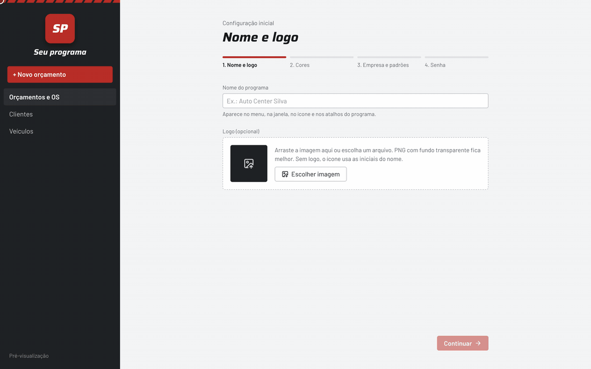
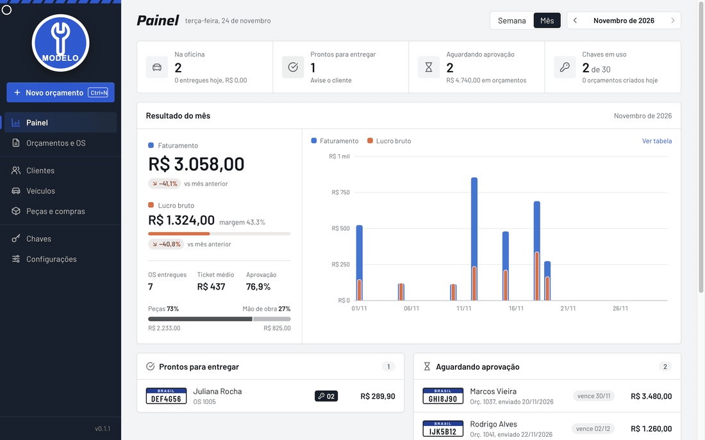
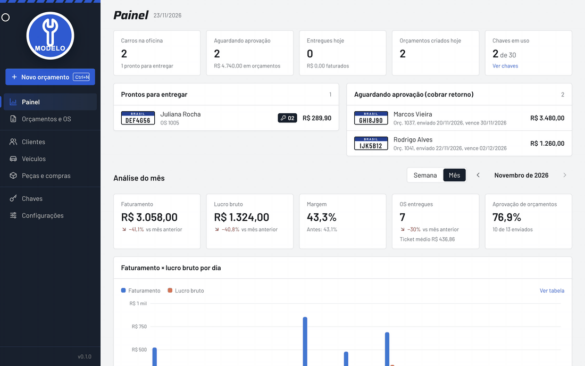
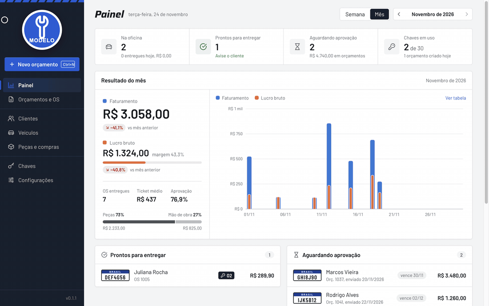

# Gestão Oficina

Sistema para oficinas mecânicas, feito para o computador do balcão: orçamentos, ordens de serviço,
clientes, veículos, chaveiros numerados e um painel com faturamento × lucro. Funciona sem internet,
com os dados no próprio computador.

Cada oficina coloca **o próprio nome, a logo e as cores** na primeira vez que abre o programa. Tudo passa
a usar essa identidade: o menu, o ícone e os atalhos do Windows e o PDF que vai para o cliente.


## Sumário

- [O que o sistema faz](#o-que-o-sistema-faz)
- [Veja funcionando](#veja-funcionando)
- [Instalação no Windows, passo a passo](#instalação-no-windows-passo-a-passo)
- [Primeiro uso: configuração inicial](#primeiro-uso-configuração-inicial)
- [Uso no dia a dia](#uso-no-dia-a-dia)
- [Atualizações](#atualizações)
- [Backup e troca de computador](#backup-e-troca-de-computador)
- [Onde ficam os dados](#onde-ficam-os-dados)
- [Perguntas frequentes](#perguntas-frequentes)
- [Como os valores são calculados](#como-os-valores-são-calculados)
- [Para desenvolvedores](#para-desenvolvedores)

## O que o sistema faz

| Tela | O que dá para fazer |
| --- | --- |
| **Painel** | Ver o dia (carros na oficina, prontos para entregar, orçamentos esperando resposta) e analisar a semana ou o mês: faturamento, lucro bruto, margem, ticket médio, taxa de aprovação e gráfico de faturamento × lucro. |
| **Orçamentos e OS** | Buscar por placa, cliente, número ou número da chave; filtrar por status. |
| **Orçamento** | Começar pela placa (carro conhecido traz o dono e o km; carro novo é cadastrado ali mesmo), lançar peças e mão de obra com sugestões do cadastro, aplicar desconto e ver o custo e o lucro internos. Gerar o PDF para o cliente. |
| **Clientes** | Cadastro com CPF/CNPJ e WhatsApp validados, carros de cada cliente e total gasto. |
| **Veículos** | Ficha com placa Mercosul, histórico de serviços, garantias vigentes e próxima troca de óleo. Troca de dono sem perder o histórico. |
| **Chaves** | Grade dos chaveiros numerados: quais estão livres e quais estão com qual carro. |
| **Configurações** | Nome, logo, cores, dados da empresa, padrões do orçamento (valor da hora, markup, validade, garantia), regra da troca de óleo, senha de acesso, atualizações e backup. |
| **Backup** | Automático todo dia (guarda os 30 últimos), backup na hora, cópia para pen drive e importação em outro computador. |

**Ainda em desenvolvimento:** enviar o orçamento pelo WhatsApp e registrar a aprovação, abrir e encerrar a
OS com a chave e registrar compras de peças.

## Veja funcionando

### Configuração inicial: nome, logo, cores e empresa

Na primeira abertura, um assistente de 4 passos. As cores aparecem no programa enquanto você escolhe.



### Orçamento: placa nova, cliente novo, peças do cadastro e PDF

A placa nova abre os campos do carro; o cliente que não existe é cadastrado junto. Ao digitar a peça, o
cadastro sugere a descrição com custo e markup. Os totais são atualizados enquanto você digita.



### Ficha do veículo: histórico, garantias e troca de óleo



### Configurações: trocar as cores e salvar



## Instalação no Windows, passo a passo

**Requisitos:** Windows 10 ou 11 (64 bits) e cerca de 400 MB livres. Não precisa ser administrador.
A internet só é usada para baixar atualizações.

1. **Baixe o instalador.** Abra a página de
   [versões publicadas](https://github.com/MatheusThiesen/gestao-oficina/releases/latest) e, em *Assets*,
   clique em `Gestao-Oficina-Setup-<versão>.exe`.

2. **Abra o arquivo baixado.** Na primeira vez, o Windows pode mostrar a tela azul
   *"O Windows protegeu o computador"*. Isso acontece porque o instalador ainda não tem assinatura digital.
   - Clique em **Mais informações**.
   - Clique em **Executar assim mesmo**.

3. **Aguarde a instalação.** Ela é automática e não faz perguntas. Leva alguns segundos e instala só para o
   usuário atual do Windows.

4. **Abra o programa.** O instalador cria o atalho **Gestão Oficina** na Área de Trabalho e no Menu Iniciar,
   e o programa abre sozinho ao terminar.

5. **Faça a configuração inicial** (próxima seção). Depois dela, os atalhos passam a ter o nome e o ícone
   da sua oficina.

> Para instalar em outro computador, repita os mesmos passos. Cada computador tem o próprio banco de dados;
> o sistema ainda não é feito para vários computadores em rede.

## Primeiro uso: configuração inicial

O assistente aparece só na primeira abertura. Tudo pode ser alterado depois em **Configurações**.

| Passo | O que preencher |
| --- | --- |
| **1. Nome e logo** | Quem está trocando de computador clica em **Importar backup** nesta tela e pula o resto ([veja como](#backup-e-troca-de-computador)). Senão: o nome do programa (ex.: *Auto Center Silva*) e, se quiser, a logo (PNG, JPG, WEBP ou SVG, até 2 MB; PNG com fundo transparente fica melhor). Sem logo, o ícone usa as iniciais do nome. |
| **2. Cores** | Uma combinação pronta ou duas cores livres: a principal (botões e destaques) e a do menu lateral. O contraste dos textos é ajustado sozinho. |
| **3. Empresa e padrões** | Nome que vai no orçamento, CNPJ, WhatsApp, endereço, valor da hora, markup padrão das peças, validade do orçamento e garantia. |
| **4. Senha** | *Sem senha* (o programa abre direto) ou *Proteger com senha* (pede a senha ao abrir e quando alguém clica em **Bloquear** no menu). |

Ao concluir, o programa abre no **Painel**.

## Uso no dia a dia

### Fazer um orçamento

1. Clique em **Novo orçamento** (ou `Ctrl+N`).
2. Digite a **placa** e tecle `Enter`.
   - Carro já atendido: o modelo, o dono e o último km aparecem sozinhos.
   - Carro novo: preencha marca, modelo e ano ali mesmo.
3. Em **Cliente**, procure por nome, telefone ou CPF. Se não existir, clique em **Cadastrar "nome"** e
   informe o WhatsApp.
4. Em **Itens**, use **Peça** e **Mão de obra**. Comece a digitar a descrição para ver as sugestões do
   cadastro; escolher uma sugestão preenche custo e markup (peça) ou horas e preço (serviço).
5. Ajuste quantidade, custo, markup ou valor da hora direto na tabela. O **Resumo** mostra o total e, no
   quadro tracejado, o custo e o lucro das peças, que são só para você.
6. Preencha as **Condições** (validade, previsão de entrega, pagamento, garantia, observações).
7. **Salvar** (`Ctrl+S`) ou **Gerar PDF**, que salva e abre o PDF pronto para mandar ao cliente.

### Atalhos de teclado

| Atalho | Ação |
| --- | --- |
| `Ctrl+N` | Novo orçamento |
| `Ctrl+F` | Ir para a busca da tela |
| `Ctrl+S` | Salvar (orçamento, cliente, veículo, configurações) |

### PDF do orçamento

Fica em `Documentos\<nome do programa>\Orçamentos\Orcamento-<número>-<placa>.pdf`. O botão de pasta ao lado
de **Gerar PDF** abre essa pasta. O PDF leva o nome, a logo e os dados da oficina e **nunca** mostra custo,
markup ou lucro.

## Atualizações

O programa verifica se há versão nova ao abrir e a cada 4 horas. Quando encontra uma, baixa em segundo
plano e mostra no menu **Reiniciar e atualizar**. Quem não clicar recebe a atualização na próxima vez que
fechar o programa. Os dados não são afetados.

Para conferir: **Configurações → Atualizações** mostra a versão instalada e tem o botão **Verificar agora**.

## Backup e troca de computador

### Backup automático

Todo dia, ao abrir o programa (e a cada 3 horas com ele aberto), é feito um backup em
`Documentos\<nome do programa>\Backups\`. Ficam os 30 mais recentes; os mais antigos são apagados sozinhos.
Em **Configurações → Backup** aparecem a data do último backup e os botões:

| Botão | O que faz |
| --- | --- |
| **Fazer backup agora** | Cria um backup na pasta de backups. |
| **Salvar cópia em…** | Salva o backup onde você escolher: pen drive, Google Drive, OneDrive… |
| **Abrir pasta** | Abre a pasta de backups. |
| **Restaurar backup…** | Substitui os dados deste computador pelos de um backup. |

O backup é **um único arquivo** (`.oficina-backup`) com tudo: clientes, veículos, orçamentos, configurações,
senha, logo e cores. Guarde uma cópia fora do computador de vez em quando.

### Trocar de computador, passo a passo

1. **No computador antigo:** abra **Configurações → Backup → Salvar cópia em…** e salve no pen drive
   (ou numa pasta da nuvem).
2. **No computador novo:** [instale o programa](#instalação-no-windows-passo-a-passo).
3. Na primeira tela da configuração inicial, clique em **Importar backup** e escolha o arquivo.
4. Confira o resumo (data do backup, nome da oficina, quantidade de clientes e orçamentos) e clique em
   **Importar e reiniciar**.
5. O programa reinicia já com tudo do computador antigo, inclusive nome, logo e cores. Se havia senha,
   ela continua a mesma.

Também dá para importar depois, em **Configurações → Backup → Restaurar backup…**. Antes de substituir, o
programa guarda uma cópia dos dados atuais (`dados.antes-da-importacao-<data>.db`). Um backup feito numa
versão mais nova do programa é recusado: atualize o computador novo antes de importar.

## Onde ficam os dados

| O quê | Onde |
| --- | --- |
| Banco de dados (clientes, veículos, orçamentos) | `%APPDATA%\Gestão Oficina\dados.db` |
| Logo e ícone gerado | `%APPDATA%\Gestão Oficina\marca\` |
| Registro de erros (para suporte) | `%APPDATA%\Gestão Oficina\logs\main.log` |
| PDFs dos orçamentos | `Documentos\<nome do programa>\Orçamentos\` |
| Backups | `Documentos\<nome do programa>\Backups\` |

Para abrir `%APPDATA%`, digite esse texto na barra de endereço do Explorador de Arquivos.

Antes de uma atualização que muda o banco, ou de importar um backup, o programa guarda uma cópia ao lado
dele (`dados.antes-da-atualizacao-<data>.db` ou `dados.antes-da-importacao-<data>.db`).

## Perguntas frequentes

**Esqueci a senha. E agora?**
Não há como recuperar a senha pelo programa. Peça ajuda a quem instalou o sistema.

**Desinstalar apaga meus dados?**
Não. Desinstale em *Configurações do Windows → Aplicativos → Gestão Oficina → Desinstalar*. A pasta
`%APPDATA%\Gestão Oficina` continua lá; se você instalar de novo, tudo volta. Mesmo assim, faça um
**Salvar cópia em…** antes, por garantia.

**Posso mudar o nome, a logo ou as cores depois?**
Sim, em **Configurações**. O menu, o ícone e os atalhos do Windows mudam ao salvar.

**O SmartScreen aparece a cada atualização?**
Não. Ele só aparece ao abrir o instalador baixado manualmente; as atualizações automáticas não passam
por ele.

## Como os valores são calculados

- **Preço da peça** = custo × (1 + markup), arredondado ao centavo. **Total da linha** = preço × quantidade.
- **Mão de obra** = horas × valor da hora, ou o preço fixo do serviço.
- **Desconto** em % sobre peças + mão de obra.
- Custo, markup e preço são **copiados para o orçamento**: mudar o cadastro da peça depois não altera
  orçamentos antigos.
- **Painel:** o faturamento soma as **OS entregues**, pela data de entrega. O **lucro bruto** é o faturamento
  menos o custo das peças, sem despesas da oficina como salários e aluguel, que o sistema não registra.
  Semana de segunda a domingo; mês do calendário; cada indicador é comparado ao período anterior.

## Para desenvolvedores

**Stack:** Electron 42 + electron-vite, React 19, TypeScript, Tailwind 4, SQLite com Prisma 7
(`@prisma/adapter-better-sqlite3`), Zod, Vitest, electron-builder (NSIS) e electron-updater.

### Rodar o projeto

Requisitos: Node 22 ou mais novo, npm e Git.

```bash
git clone https://github.com/MatheusThiesen/gestao-oficina.git
cd gestao-oficina
npm install      # gera o Prisma Client e instala o SQLite já compilado para o Electron
npm run dev      # abre o programa
```

Em desenvolvimento, o banco começa com **dados de exemplo** (clientes, carros, orçamentos e serviços
entregues), para o painel e as telas terem conteúdo.

### Comandos

| Comando | Para quê |
| --- | --- |
| `npm run dev` | Programa em modo desenvolvimento, com recarga automática da tela |
| `npm test` | Testes do domínio (cálculo do orçamento, validações, períodos do painel, PDF…) |
| `npm run typecheck` / `npm run lint` | Tipos e lint |
| `npm run db:migrate -- --name descricao` | Nova migration a partir do `prisma/schema.prisma` |
| `npm run dist:win` | Instalador do Windows local, sem publicar (rodar no Windows) |
| `npm run build && npm run docs:gifs` | Regrava os GIFs deste README (precisa do `ffmpeg`) |

### Estrutura

```
src/main/
  domain/        regras puras, sem Electron nem banco: cálculo, validações, períodos (com testes)
  application/   casos de uso: salvar orçamento, painel, PDF, configuração inicial, bloqueio
  infra/         Prisma/SQLite, repositórios, migrations, PDF, logo e ícone, atualizações, log
  ipc/           canais IPC com validação de entrada (Zod)
src/preload/     API tipada exposta à tela (contextIsolation + sandbox, sem Node na tela)
src/renderer/    React: páginas, componentes, marca (cores, logo, assistente)
src/shared/      contratos IPC, tipos e formatação usados pelos dois lados
prisma/          schema e migrations (aplicadas pelo próprio programa ao abrir)
scripts/         gravação dos GIFs
docs/            GIFs e logo fictícia das demonstrações
```

### Decisões que valem saber

- **Dinheiro e percentuais são inteiros:** centavos (`12000` = R$ 120,00), centésimos de ponto percentual
  (`4000` = 40%) e milésimos de quantidade (`1500` = 1,5). Nada de ponto flutuante nos cálculos.
- **Migrations sem a CLI do Prisma:** o programa instalado aplica os `.sql` pendentes de
  `prisma/migrations`, cada um numa transação, e registra em `_app_migrations`.
- **Electron 42:** é a versão mais nova com o SQLite (`better-sqlite3`) já compilado; versões mais novas
  exigiriam compilar o módulo nativo.
- **Nome sem acento no empacotamento:** o pacote se chama `Gestao Oficina` / `GestaoOficina`, porque o "ã"
  derruba o Electron no macOS. O usuário vê o nome que escolheu; atalhos e pasta de dados usam
  "Gestão Oficina".
- **Senha:** guardada como hash scrypt. Com o programa bloqueado, o processo principal recusa qualquer
  pedido de dados, não só a tela.
- **Cores dos gráficos** são fixas e validadas para daltonismo; não seguem a cor da marca.

### Publicar uma versão

Resumo (detalhes em [PUBLICAR.md](PUBLICAR.md)):

```bash
npm version patch       # 0.1.0 → 0.1.1, cria o commit e a tag
git push --follow-tags  # o GitHub Actions gera o instalador e publica na Release
```
